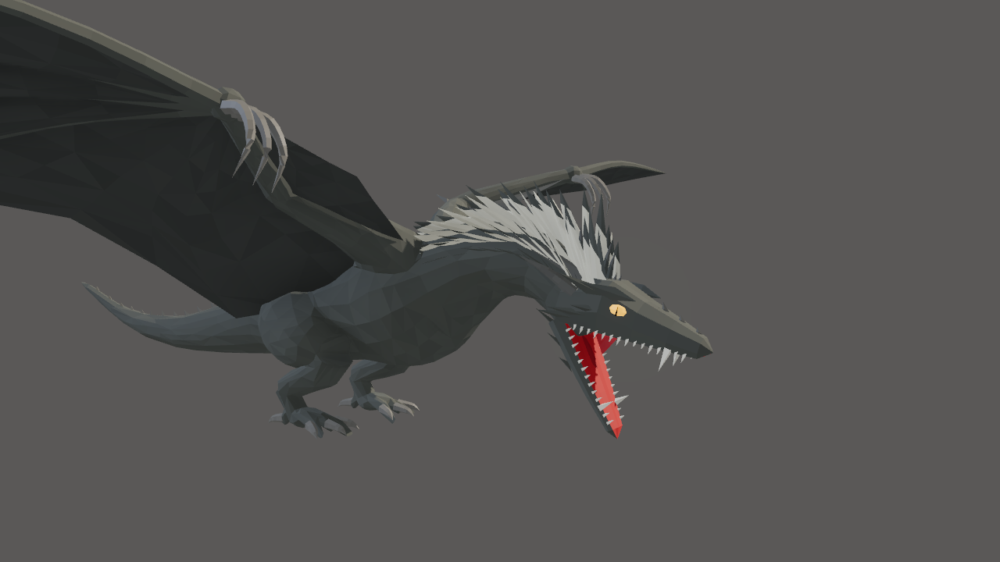

# 🐉 3D Dragon Game

Gra 3D o smoku tworzona w **Godot 4.7**, z assetami generowanymi proceduralnie
w **Blenderze** (skrypty Pythona).



## Uruchomienie

1. Zainstaluj [Godot 4.7](https://godotengine.org/download) (wersja standardowa, GDScript).
2. Otwórz `project.godot` w edytorze i naciśnij **F5**.

## Praca z assetami (Linux)

```bash
tools/setup.sh   # Godot, Blender (bpy) w .venv-tools, xvfb/mesa
.venv-tools/bin/python tools/blender/gen_dragon.py   # -> assets/models/dragon.glb (model + rig + animacje)
tools/check.sh   # weryfikacja projektu bez ekranu
```

## Dokumenty

- [ROADMAP.md](ROADMAP.md): plan rozwoju
- [CLAUDE.md](CLAUDE.md): konwencje i instrukcje dla agentów AI
- [docs/ART_STYLE.md](docs/ART_STYLE.md): wybór stylu graficznego
- [docs/TOOLS.md](docs/TOOLS.md): darmowe narzędzia (3D, Godot, assety)
