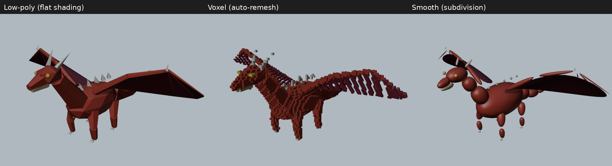
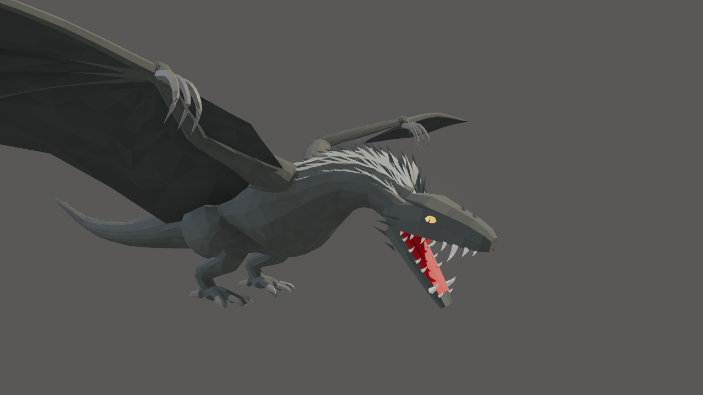
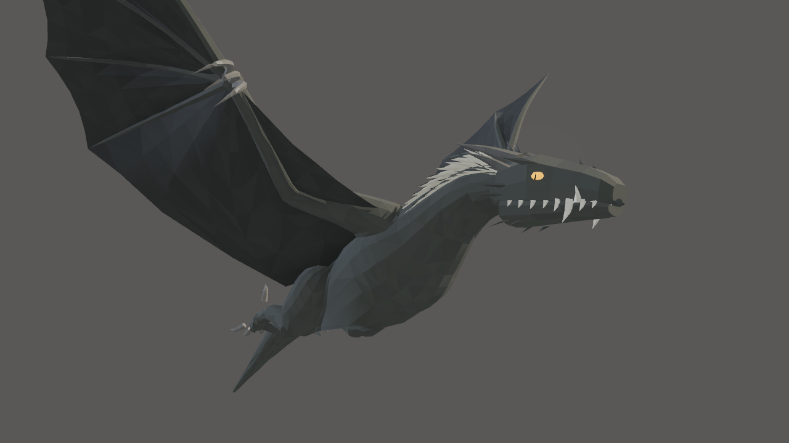
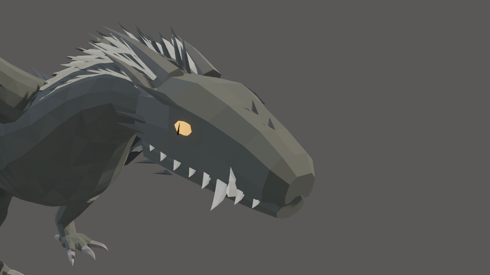
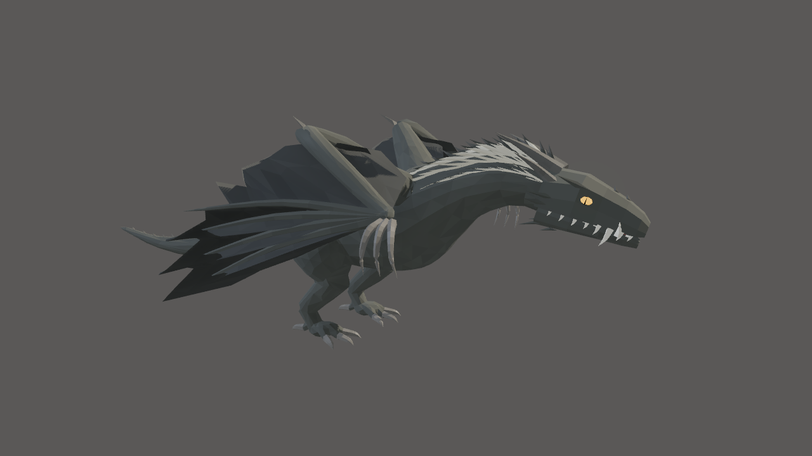

# Styl graficzny — analiza opcji

*Ten sam proceduralny smok przepuszczony przez trzy automatyczne przekształcenia.
To porównanie techniczne, a nie „najlepsza wersja” każdego stylu: voxel i
smooth wymagałyby modeli budowanych od początku pod dany styl.*

## Kryteria

Assety tworzy głównie agent AI **kodem** (skrypty Blendera), bez ręcznego
rzeźbienia. Gra o smoku ma duże otwarte przestrzenie widziane z lotu, więc
liczy się wydajność, czytelność sylwetki z daleka i spójność setek assetów.

| Styl | Jak dobrze agent go wygeneruje | Wydajność, duże światy | Animacja smoka | Uwagi |
|---|---|---|---|---|
| **Low-poly (flat)** | ⭐⭐⭐⭐⭐ bryły, kolory per materiał, zero tekstur | ⭐⭐⭐⭐⭐ | ⭐⭐⭐⭐ rig na kościach działa dobrze | Najłatwiej o spójność. Ryzyko: „generyczny” wygląd, trzeba dopracować paletę i oświetlenie. |
| **Voxel** | ⭐⭐⭐⭐ siatka 3D to dla kodu naturalny format (`.vox`, MagicaVoxel) | ⭐⭐⭐⭐ (teren wymaga chunkingu) | ⭐⭐ cienkie skrzydła i płynny lot wyglądają kanciasto; animacja zwykle klatkowa | Świetne, jeśli chcemy niszczalny / budowalny świat. |
| **Kreskówkowy (smooth + toon shader)** | ⭐⭐⭐ wymaga gładkiej topologii (skin modifier, metaballe, sculpt) — trudniejsze | ⭐⭐⭐⭐ | ⭐⭐⭐⭐ | Toon shader + kontury dodają dużo charakteru. Może być rozwinięciem low-poly. |
| **Realistyczny** | ⭐ wymaga rzeźbienia, tekstur PBR, skanów lub modeli AI z GPU | ⭐⭐ | ⭐⭐ | Odradzane: najwyższy koszt, a efekt agenta byłby najsłabszy. |

## Rekomendacja

**Stylizowany low-poly** z ciepłą paletą, flat shadingiem, mgłą atmosferyczną
i ewentualnie lekkim toon shaderem lub obrysem. Przykłady klimatu: *Grow
Home*, *Journey*, *A Short Hike* (wersja 3D). Uzasadnienie:

1. Agent zrobi w nim najwięcej i najlepiej (pipeline już działa, patrz model smoka).
2. Najlepsza wydajność przy dużym świecie oglądanym z lotu ptaka.
3. Łatwo podnieść jakość później: shader toon, obrys, gradient na materiałach,
   bez wymiany wszystkich modeli.
4. Darmowe paczki CC0 (Kenney, Quaternius) też są low-poly, więc pasują stylistycznie.

**Alternatywa:** voxel, jeśli rdzeniem gry ma być budowanie lub niszczenie świata.

## Decyzja

✅ **Stylizowany low-poly** (listopad 2026). Pierwszy docelowy asset — smok
na podstawie referencji (szary, kremowa grzywa, czerwony pysk):

